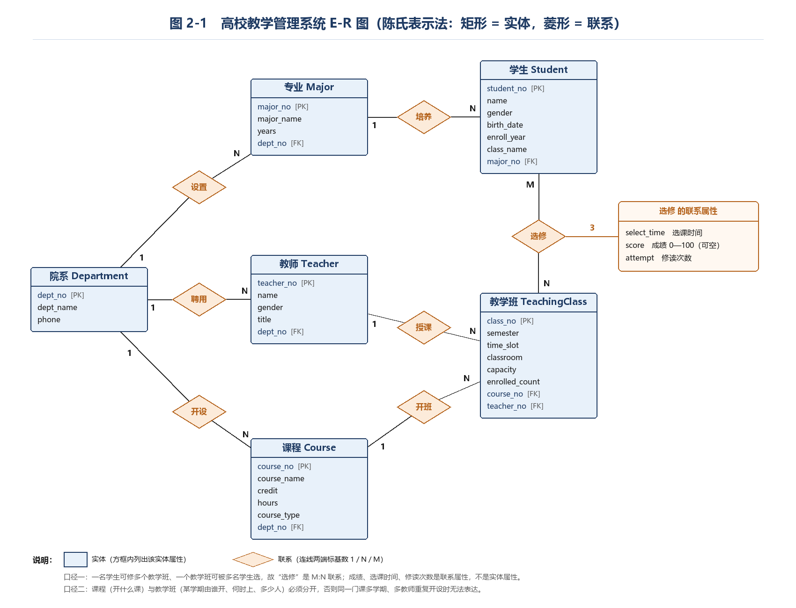

# 任务二　数据库概念结构设计：实体属性表与联系说明

> 项目：高校教学管理系统　|　版本：v0.1（待评审）　|　负责人：组长
> 配套文件：`ER图.png`（陈氏表示法）、`ER图.mmd`（Mermaid 源码，可在线渲染）
> 上游依据：`01_项目需求分析/需求分析报告.md`（角色、流程、B1—B16 业务规则）

---

## 一、设计约定（先看这里，后面所有表都按这个口径读）

| 约定 | 内容 | 理由 |
|---|---|---|
| 主键策略 | **业务主键**：`dept_no`、`major_no`、`student_no`、`teacher_no`、`course_no`、`class_no` | 这些编号在教务处本就是唯一标识；用它做外键，表与表之间"看得懂"，选课表的主键也自然是 (student_no, class_no) |
| 命名 | 小写下划线；主键 `<实体>_no`；外键与所引用主键同名 | 外键列名与主键列名一致，写 JOIN 时不用查表 |
| 属性粒度 | 只保留不可再分的原子属性；**能算出来的不进实体** | 避免 1NF/3NF 问题，如"毕业年份 = 入学年份 + 学制"，不存 |
| 实体划分 | 课程（Course）与教学班（TeachingClass）**必须分开** | 同一门课在不同学期、由不同教师开，会形成多个班；合并则无法表达（见五.1） |
| 冗余字段 | 仅 `teaching_class.enrolled_count` 一个冗余字段，且必须说明理由 | 并发选课需要"锁行 + 校验名额"，每次 COUNT 聚合代价太高（见五.3） |

---

## 二、实体清单

| 编号 | 实体 | 存在理由 | 对应需求条目 |
|---|---|---|---|
| E1 | 院系 Department | 教学组织的一级单位，是专业、教师、开课课程的归属 | 二.2.1 基础数据管理 |
| E2 | 专业 Major | 学生按专业培养；专业隶属院系（两级组织，不能只做一个"专业"字段） | 二.2.1、三.3.1 |
| E3 | 学生 Student | 选课与成绩的主体 | 二.2.1、三.3.2 |
| E4 | 教师 Teacher | 授课与成绩录入的责任主体 | 二.2.2、三.3.4 |
| E5 | 课程 Course | 课程库中的"课"，与学期无关 | 三.3.1 |
| E6 | 教学班 TeachingClass | 某学期某课程开出的具体班级，是选课的对象 | 三.3.1、三.3.2 |

> 说明：需求文档里出现的"选课"不是实体，而是学生与教学班之间的 **M:N 联系**，见第三章。它在逻辑设计阶段才转为独立表 `enrollment`。

---

## 三、实体属性表

### 3.1 院系 Department（E1）

| 属性 | 含义 | 数据类型 | 允许空 | 键 |
|---|---|---|---|---|
| dept_no | 院系号，如 `CS` | CHAR(4) | 否 | PK |
| dept_name | 院系名称，如"计算机学院" | VARCHAR(50) | 否 | 唯一 |
| phone | 办公电话 | VARCHAR(20) | 是 | — |

**候选主键**：`dept_no`（业务主键）、`dept_name`（业务上唯一，但改名时会牵连，故选前者）。

### 3.2 专业 Major（E2）

| 属性 | 含义 | 数据类型 | 允许空 | 键 |
|---|---|---|---|---|
| major_no | 专业号，如 `080901` | CHAR(6) | 否 | PK |
| major_name | 专业名称 | VARCHAR(50) | 否 | — |
| years | 学制（年），如 4 | TINYINT | 否 | — |
| dept_no | 所属院系 | CHAR(4) | 否 | FK → department.dept_no |

**候选主键**：`major_no`。
**说明**：`years` 放在专业而非学生——同一专业学生学制相同，放学生表会产生传递依赖（学号 → 专业 → 学制）。

### 3.3 学生 Student（E3）

| 属性 | 含义 | 数据类型 | 允许空 | 键 |
|---|---|---|---|---|
| student_no | 学号，如 `2024302111372` | CHAR(13) | 否 | PK |
| name | 姓名 | VARCHAR(30) | 否 | — |
| gender | 性别（男/女） | CHAR(1) | 否 | — |
| birth_date | 出生日期 | DATE | 是 | — |
| enroll_year | 入学年份，如 2024 | SMALLINT | 否 | — |
| class_name | 行政班级，如"计科2401" | VARCHAR(20) | 是 | — |
| major_no | 所属专业 | CHAR(6) | 否 | FK → major.major_no |

**候选主键**：`student_no`。
**刻意不设的属性**：`age`（可由出生日期算）、`dept_no`（经专业间接得到，存了就违反 3NF）、`gpa`（由成绩聚合而来）。

### 3.4 教师 Teacher（E4）

| 属性 | 含义 | 数据类型 | 允许空 | 键 |
|---|---|---|---|---|
| teacher_no | 工号，如 `T2019013` | CHAR(9) | 否 | PK |
| name | 姓名 | VARCHAR(30) | 否 | — |
| gender | 性别 | CHAR(1) | 否 | — |
| title | 职称（教授/副教授/讲师/助教） | VARCHAR(10) | 是 | — |
| dept_no | 所属院系 | CHAR(4) | 否 | FK → department.dept_no |

**候选主键**：`teacher_no`。

### 3.5 课程 Course（E5）

| 属性 | 含义 | 数据类型 | 允许空 | 键 |
|---|---|---|---|---|
| course_no | 课程号，如 `CS3001` | CHAR(8) | 否 | PK |
| course_name | 课程名称 | VARCHAR(60) | 否 | — |
| credit | 学分（0.5—10，0.5 的倍数） | DECIMAL(3,1) | 否 | — |
| hours | 学时 | SMALLINT | 否 | — |
| course_type | 课程性质（必修/选修/公选） | VARCHAR(10) | 否 | — |
| dept_no | 开课院系 | CHAR(4) | 否 | FK → department.dept_no |

**候选主键**：`course_no`。
**说明**：这里**没有**教师、学期、上课时间、容量——这些属于"某学期开出的那个班"，一律移到 E6。

### 3.6 教学班 TeachingClass（E6）

| 属性 | 含义 | 数据类型 | 允许空 | 键 |
|---|---|---|---|---|
| class_no | 教学班号，如 `2026-1-CS3001-01` | VARCHAR(24) | 否 | PK |
| semester | 开课学期，如 `2026-1` | CHAR(6) | 否 | — |
| time_slot | 上课时间，如 `周一3-4节` | VARCHAR(20) | 否 | — |
| classroom | 上课教室，如 `教三-201` | VARCHAR(20) | 是 | — |
| capacity | 容量上限 | SMALLINT | 否 | — |
| enrolled_count | 已选人数（冗余字段，见 5.3） | SMALLINT | 否 | — |
| course_no | 所开课程 | CHAR(8) | 否 | FK → course.course_no |
| teacher_no | 任课教师 | CHAR(9) | 否 | FK → teacher.teacher_no |

**候选主键**：`class_no`。

---

## 四、联系说明

| 编号 | 联系 | 参与实体 | 类型 | 参与度 | 说明（含判定依据） |
|---|---|---|---|---|---|
| R1 | 设置 | 院系 — 专业 | 1 : N | 全部 | 一个院系开设若干专业；一个专业只属于一个院系（专业必须有归属，故专业侧全部参与） |
| R2 | 聘用 | 院系 — 教师 | 1 : N | 全部 | 一名教师只隶属一个院系（可兼职的情形本系统不建模，列入范围外） |
| R3 | 开设 | 院系 — 课程 | 1 : N | 全部 | 课程归属开课院系；一门课只有一个开课院系 |
| R4 | 培养 | 专业 — 学生 | 1 : N | 全部 | 一名学生只在一个专业；一个专业有多名学生 |
| R5 | 开班 | 课程 — 教学班 | 1 : N | 全部 | 一门课可开出多个教学班；一个教学班只对应一门课 |
| R6 | 授课 | 教师 — 教学班 | 1 : N | 全部 | 一名教师可上多个班；一个班由一名教师主讲（不建模"多人合上"） |
| R7 | **选修** | 学生 — 教学班 | **M : N** | 全部 | 一名学生可选多个教学班；一个教学班可被多名学生选。**联系属性：select_time（选课时间）、score（成绩）、attempt（修读次数）** |

### 4.1 为什么"选修"必须是 M:N 且带联系属性

- 若把"成绩"塞进学生实体：一个学生有多门课，一门课一个成绩字段，字段无限膨胀 → 违反 1NF，且新增一门课就要改表结构。
- 若把"成绩"塞进教学班实体：一个班有多名学生，同样无法表达。
- 成绩只取决于"**某个学生** 在 **某个教学班**"，是典型的联系属性；逻辑设计时随 M:N 联系一起转为 `enrollment` 表，主键为 (student_no, class_no)，成绩就是它的普通字段。

### 4.2 联系属性的取值约束（对应任务一的规则）

| 联系属性 | 约束 | 对应规则 |
|---|---|---|
| select_time | NOT NULL，默认当前时间 | — |
| score | 可空（未录入），非空时 0—100 | B10 |
| attempt | 默认 1，重修时 +1 | Q3 结论（覆盖原成绩，另计次数） |

---

## 五、四个需要能讲清的设计决策（答辩就用这几条）

### 5.1 课程与教学班为什么必须拆开

同一门《数据库系统》，2025 秋由张老师开一个班、2026 春由李老师开另一个班，两个班的上课时间、教室、容量都不同。若合并成一张"课程表"，就要为每个学期复制一条课程记录，课程号不再唯一，学分、学时被重复存储——**插入异常（新开一个班要重抄课程信息）、删除异常（删掉一个班，课程信息一起消失）、更新异常（改学分要改多处）** 全部出现。拆开后：课程是"课的定义"，教学班是"某学期的一次开课"，1:N 关系。

### 5.2 为什么要院系—专业两级，而不是只留专业

若学生表只存"专业"，则"该专业属于哪个院系"无处存放；若学生在表里同时存 `major_no` 和 `dept_no`，则 `学号 → major_no → dept_no` 形成传递依赖，不是 3NF。设两级实体后，院系信息只存一处。

### 5.3 `enrolled_count` 是冗余字段，为什么还留

严格说它可由 `SELECT COUNT(*) FROM enrollment WHERE class_no = ?` 算出，属于派生数据。保留的理由：选课事务要"锁住教学班那一行 → 判断已选人数是否小于容量 → +1"，若每次都聚合选课表，锁的粒度与代价都不可控；且选课高峰并发高。
**代价**：必须用事务保证它与选课记录一致（选课 +1、退课 −1 同一事务）；并提供一个校验查询，在测试时验证"已选人数 = 实际记录数"。这一条会写进任务三的范式分析与任务四的校验 SQL。

### 5.4 为什么没有"教室""时间段""选课窗口"实体

14 天工期下，教室与时间段只作为教学班的属性，教室冲突规则用 `UNIQUE(classroom, semester, time_slot)` 保证（B14）；选课窗口简化为配置项而非独立表（Q5 结论）。
**代价**：无法表达"教室容量""时间段字典"。这一点在任务一的"范围外"里已声明，答辩时要主动说明是取舍，不是遗漏。

---

## 六、E-R 图

- 陈氏表示法：矩形 = 实体（框内列出属性），菱形 = 联系，连线两端标基数。
- 可编辑版本：`ER图.mmd`（Mermaid 源码），粘贴到 <https://mermaid.live> 即可重新渲染；注意 Mermaid 不支持直接画 M:N，源码里把"选修"画成了 `ENROLLMENT` 关联表，这是逻辑视角，与本文档的 M:N 联系等价。

---

## 七、需求与实体的追溯（评分关注：实体不能凭空来）

| 任务一的需求 / 规则 | 落在哪里 |
|---|---|
| 角色：学生选课、退课 | R7 选修 + 学生、教学班 |
| 角色：教师录成绩 | R7 联系属性 score |
| 流程 3.1 排课 | 教学班（E6）与 开班（R5）、授课（R6） |
| 流程 3.2 选课 | R7 + 规则 B8/B9 |
| 流程 3.5 统计 | 跨 E3/E5/E6 + R7 的连接聚合 |
| B1 学号唯一 | 学生主键 |
| B3 专业必属院系 | R1 + major.dept_no NOT NULL |
| B11 成绩随退课失效 | 成绩作为 R7 联系属性 |
| B14 教室不冲突 | teaching_class 上的唯一约束 |

---

## 八、AI 辅助与人工修正

Prompt 原文与模型输出见 [`07_AI辅助过程/AI交互记录.md`](../07_AI辅助过程/AI交互记录.md)。本节只保留"人工修正了什么"，作为任务六 6.2 评价的素材。

| 模型初稿的典型问题 | 本设计的处理 | 怎么验证 |
|---|---|---|
| 把教师、学期、容量塞进课程实体 | 拆成 E5 课程 + E6 教学班 | 检查同一门课能否开出"时间不同、教师不同"的多个班 |
| 把成绩做成学生的属性 | 移入 R7 选修的联系属性 | 检查一名学生的多门课成绩能否各存一行 |
| 画了 M:N 却没挂联系属性 | R7 明确挂 select_time / score / attempt | 检查退课后成绩是否随之消失 |
| 学生表同时存专业与院系 | 删除 `student.dept_no` | 检查是否只剩"学号 → 专业 → 院系"一条路径 |

> 完成一次真实对话后，请对照上表勾选：模型确实犯了哪几条、你是怎么发现的、改后如何验证。**没遇到的不要硬凑**——写一条真实发现，比凑四条更有说服力。

---

## 九、自检清单

- [ ] 实体 6 个（≥5），每个实体能追溯到需求条目
- [ ] 至少一个 M:N（选修），且 M:N 已带联系属性
- [ ] 全图无"同一信息存两处"（除 enrolled_count，且已说明理由）
- [ ] 每个联系的基数都有业务依据，不是凑数
- [ ] 属性都不可再分（1NF）、无传递依赖（3NF 预检）
- [ ] 图与表一一对应：图上每个属性都在属性表里，反之亦然
